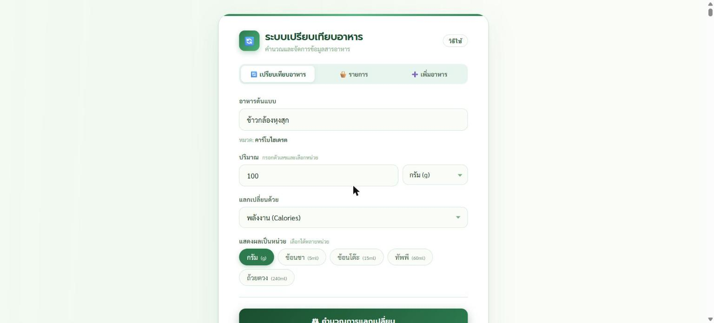
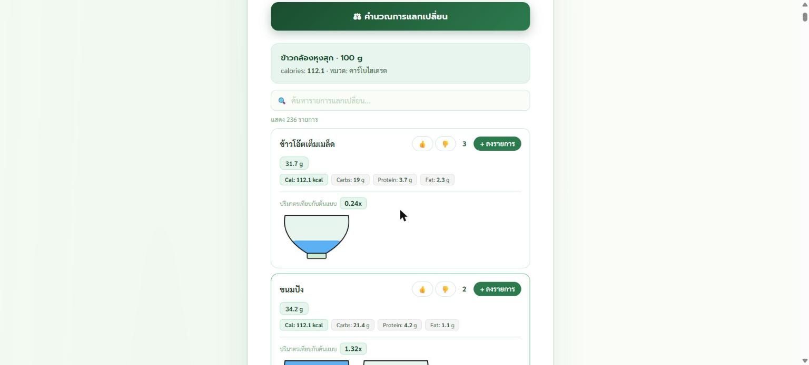
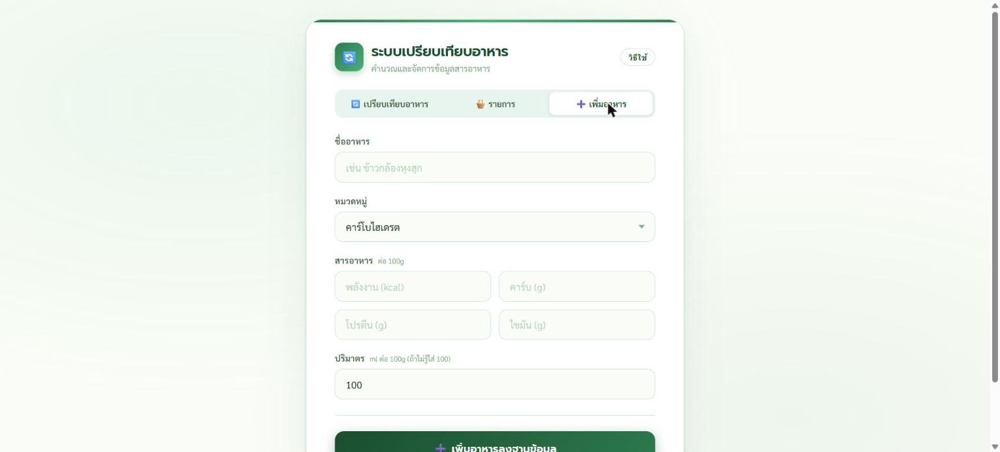

# ระบบเปรียบเทียบอาหาร (Food Comparison / Exchange System)

**🇬🇧 [English](#english) | 🇹🇭 [ภาษาไทย](#ภาษาไทย)**

**Live demo / เว็บที่ใช้งานได้จริง:**
- Frontend: https://cufoodexchange-frontend.vercel.app
- Backend API: https://cufoodexchange.vercel.app

## Screenshots

| Compare foods | Exchange results | Add food |
|---|---|---|
|  |  |  |

---

## English

A food-exchange calculator for nutrition planning: pick a food and an amount, and the app finds equivalent amounts of other foods in the same category with matching nutrient value (calories, carbs, protein, or fat). Built as a capstone project, based on the food exchange list from Thanyarak Pattani Hospital.

### Features

- **Compare foods** — select a food, an amount, and a nutrient (calories/carbs/protein/fat), and get a list of equivalent amounts of other foods in the same category, each scaled to match the chosen nutrient.
- **Category-aware UI** — nutrient options are locked per category (e.g. dairy and fruit only compare by calories), with color-coded bowls and sub-category tags (e.g. low-fat / high-fat protein, whole/skim milk).
- **Food list builder** (optional tab) — add foods to a running list and see total macros; kept in memory only (resets on refresh).
- **Add new foods** — append entries to the database (name, category, sub-category, macros per 100 g, volume), protected by a shared password.
- **Rating system** — 👍 / 👎 a food to bump its sort priority; results are sorted by rating first, then alphabetically (Thai locale).
- **In-app help modal** — walkthrough of every tab, the color scheme, and the rating system.

### Tech stack

- **Backend**: Node.js, Express 5, Mongoose 9 (MongoDB)
- **Frontend**: plain HTML/CSS/JavaScript, no build step
- **Database**: MongoDB (Atlas)
- **Hosting**: Vercel (two separate projects — one per folder, see [Deployment](#deployment))

### Project structure

```
Foodexchange/
├── backend/
│   ├── api/
│   │   └── index.js        # Vercel serverless entry point (wraps server.js)
│   ├── models/
│   │   └── Food.js         # Mongoose schema
│   ├── utils/
│   │   └── calculator.js   # Exchange-amount math
│   ├── server.js            # Express app + routes
│   ├── vercel.json
│   └── package.json
└── frontend/
    └── index.html           # Entire frontend (markup + styles + JS)
```

### API reference

Base URL: `http://localhost:8000` (local) or the deployed backend URL.

| Method | Path | Description |
|---|---|---|
| GET | `/foods` | List all foods |
| POST | `/exchange-food` | Calculate equivalent amounts of other foods in the same category |
| POST | `/add-food` | Add a new food (requires password) |
| POST | `/rate-food` | +1 rating point for a food |
| POST | `/unrate-food` | -1 rating point for a food |

<details>
<summary><code>POST /exchange-food</code> — request body</summary>

```json
{ "foodName": "ข้าวขาวหุงสุก", "amount": 100, "nutrientType": "calories" }
```
`amount` is always in grams. `nutrientType` is one of `calories`, `carbs`, `protein`, `fat`.
</details>

<details>
<summary><code>POST /add-food</code> — request body</summary>

```json
{
  "password": "<ADD_FOOD_PASSWORD>",
  "name": "ไก่อกสุก",
  "category": "โปรตีน",
  "sub_category": "ไม่มีไขมัน",
  "calories": 165,
  "carbs": 0,
  "protein": 31,
  "fat": 3.6,
  "volume": 100
}
```
</details>

#### Food document shape

```js
{
  name:         String,  // food name
  category:     String,  // carb / protein / fat / dairy / fruit
  sub_category: String,  // e.g. fat level for protein/dairy, "-" otherwise
  calories:     Number,  // kcal per 100 g
  carbs:        Number,  // g per 100 g
  protein:      Number,  // g per 100 g
  fat:          Number,  // g per 100 g
  volume:       Number,  // ml per 100 g (default 100)
  points:       Number,  // rating score (default 0)
}
```

### Getting started

#### Prerequisites

- Node.js
- A MongoDB connection string (local instance or Atlas)

#### Backend

```bash
cd backend
npm install
```

Create `backend/.env`:

```
MONGODB_URI=<your-mongodb-connection-string>
ADD_FOOD_PASSWORD=<choose-a-password>
PORT=8000
```

```bash
npm start
```

The API runs at `http://localhost:8000`.

#### Frontend

The frontend is a single static `index.html` with no build step — open it directly in a browser, or serve it with any static server (e.g. VS Code's Live Server). It auto-detects localhost vs. production and points at the matching backend URL (see `backend_uri` near the top of the `<script>` block in `frontend/index.html`).

### Deployment

Deployed as two separate Vercel projects (one per folder, each with its own Root Directory setting):

- **Backend** — Root Directory = `backend`. `backend/api/index.js` re-exports the Express app from `server.js` so Vercel runs it as a Node serverless function; `vercel.json` rewrites all routes to it.
- **Frontend** — Root Directory = `frontend`, framework preset "Other" (static).

Required environment variables on the backend project: `MONGODB_URI`, `ADD_FOOD_PASSWORD`.

> **Note on serverless + Mongoose**: the backend reuses a single Mongoose connection across invocations and caps `maxPoolSize` to avoid exhausting a free-tier MongoDB Atlas cluster's connection limit on cold starts.

### Acknowledgments

Food exchange data adapted from the food exchange list published by Thanyarak Pattani Hospital.

[⬆ Back to top](#ระบบเปรียบเทียบอาหาร-food-comparison--exchange-system)

---

## ภาษาไทย

เครื่องคำนวณการแลกเปลี่ยนอาหารสำหรับวางแผนโภชนาการ: เลือกอาหารและปริมาณ แล้วระบบจะหาปริมาณของอาหารอื่นในหมวดหมู่เดียวกันที่ให้ค่าสารอาหาร (แคลอรี่ คาร์โบไฮเดรต โปรตีน หรือไขมัน) เทียบเท่ากัน จัดทำเป็นโครงงานสหกิจศึกษา/แคปสโตน อ้างอิงจากรายการอาหารแลกเปลี่ยนของโรงพยาบาลธัญญารักษ์ปัตตานี

### ฟีเจอร์

- **เปรียบเทียบอาหาร** — เลือกอาหาร ปริมาณ และสารอาหาร (แคลอรี่/คาร์บ/โปรตีน/ไขมัน) เพื่อดูรายการปริมาณของอาหารอื่นในหมวดเดียวกันที่ให้สารอาหารเท่ากัน
- **UI ที่ปรับตามหมวดหมู่** — ตัวเลือกสารอาหารจะถูก lock ตามหมวดหมู่ (เช่น นมและผลไม้เทียบได้แค่แคลอรี่) พร้อมชามสีตามหมวดและป้าย sub-category (เช่น โปรตีนไขมันน้อย/สูง, นมธรรมดา/พร่องมันเนย)
- **แท็บรายการอาหาร** (ออปชันนัล) — เพิ่มอาหารลงตะกร้าและดูสรุปสารอาหารรวม เก็บไว้ใน memory เท่านั้น (หายเมื่อ refresh)
- **เพิ่มอาหารใหม่** — เพิ่มข้อมูลอาหารลงฐานข้อมูล (ชื่อ หมวดหมู่ หมวดย่อย สารอาหารต่อ 100 กรัม ปริมาตร) ต้องใช้รหัสผ่านร่วม
- **ระบบให้คะแนน** — กด 👍 / 👎 เพื่อปรับลำดับการแสดงผล ผลลัพธ์จะเรียงตามคะแนนก่อน แล้วตามด้วยชื่อ (เรียงแบบภาษาไทย)
- **ป๊อปอัปวิธีใช้** — อธิบายการใช้งานทุกแท็บ สีที่ใช้ และระบบคะแนน

### เทคโนโลยีที่ใช้

- **Backend**: Node.js, Express 5, Mongoose 9 (MongoDB)
- **Frontend**: HTML/CSS/JavaScript ล้วน ไม่มี build step
- **Database**: MongoDB (Atlas)
- **Hosting**: Vercel (แยก 2 โปรเจกต์ — หนึ่งต่อหนึ่งโฟลเดอร์ ดู [การ Deploy](#การ-deploy))

### โครงสร้างโปรเจกต์

```
Foodexchange/
├── backend/
│   ├── api/
│   │   └── index.js        # จุดเข้า serverless ของ Vercel (เรียก server.js)
│   ├── models/
│   │   └── Food.js         # Mongoose schema
│   ├── utils/
│   │   └── calculator.js   # สูตรคำนวณการแลกเปลี่ยน
│   ├── server.js            # Express app + routes
│   ├── vercel.json
│   └── package.json
└── frontend/
    └── index.html           # frontend ทั้งหมด (markup + styles + JS)
```

### API ที่มีให้ใช้

Base URL: `http://localhost:8000` (local) หรือ URL ของ backend ที่ deploy ไว้

| Method | Path | หน้าที่ |
|---|---|---|
| GET | `/foods` | ดึงรายการอาหารทั้งหมด |
| POST | `/exchange-food` | คำนวณปริมาณอาหารอื่นในหมวดเดียวกันที่ให้สารอาหารเท่ากัน |
| POST | `/add-food` | เพิ่มอาหารใหม่ (ต้องใช้รหัสผ่าน) |
| POST | `/rate-food` | +1 คะแนนให้อาหาร |
| POST | `/unrate-food` | -1 คะแนนให้อาหาร |

<details>
<summary><code>POST /exchange-food</code> — รูปแบบ request body</summary>

```json
{ "foodName": "ข้าวขาวหุงสุก", "amount": 100, "nutrientType": "calories" }
```
`amount` เป็นหน่วยกรัมเสมอ `nutrientType` เลือกได้จาก `calories`, `carbs`, `protein`, `fat`
</details>

<details>
<summary><code>POST /add-food</code> — รูปแบบ request body</summary>

```json
{
  "password": "<ADD_FOOD_PASSWORD>",
  "name": "ไก่อกสุก",
  "category": "โปรตีน",
  "sub_category": "ไม่มีไขมัน",
  "calories": 165,
  "carbs": 0,
  "protein": 31,
  "fat": 3.6,
  "volume": 100
}
```
</details>

#### โครงสร้างข้อมูลอาหาร (Food document)

```js
{
  name:         String,  // ชื่ออาหาร
  category:     String,  // คาร์โบไฮเดรต / โปรตีน / ไขมัน / นม / ผลไม้
  sub_category: String,  // เช่น ระดับไขมันสำหรับโปรตีน/นม, "-" ถ้าไม่มี
  calories:     Number,  // kcal ต่อ 100 กรัม
  carbs:        Number,  // กรัม ต่อ 100 กรัม
  protein:      Number,  // กรัม ต่อ 100 กรัม
  fat:          Number,  // กรัม ต่อ 100 กรัม
  volume:       Number,  // มิลลิลิตร ต่อ 100 กรัม (default 100)
  points:       Number,  // คะแนน rating (default 0)
}
```

### เริ่มต้นใช้งาน

#### สิ่งที่ต้องมีก่อน

- Node.js
- Connection string ของ MongoDB (ติดตั้ง local หรือใช้ Atlas)

#### Backend

```bash
cd backend
npm install
```

สร้างไฟล์ `backend/.env`:

```
MONGODB_URI=<connection-string-ของคุณ>
ADD_FOOD_PASSWORD=<ตั้งรหัสผ่านเอง>
PORT=8000
```

```bash
npm start
```

API จะรันอยู่ที่ `http://localhost:8000`

#### Frontend

Frontend เป็นไฟล์ `index.html` ไฟล์เดียว ไม่มี build step — เปิดในเบราว์เซอร์ได้เลย หรือใช้ static server ใดก็ได้ (เช่น Live Server ของ VS Code) ระบบจะตรวจจับอัตโนมัติว่าเป็น localhost หรือ production แล้วชี้ไปที่ backend URL ที่ตรงกัน (ดูตัวแปร `backend_uri` ใกล้ด้านบนของ `<script>` ใน `frontend/index.html`)

### การ Deploy

Deploy เป็น 2 โปรเจกต์ Vercel แยกกัน (หนึ่งต่อหนึ่งโฟลเดอร์ แต่ละโปรเจกต์ตั้ง Root Directory ของตัวเอง):

- **Backend** — Root Directory = `backend` โดย `backend/api/index.js` export Express app จาก `server.js` ออกมาเพื่อให้ Vercel รันเป็น Node serverless function; `vercel.json` ทำ rewrite ทุก route ไปที่จุดนี้
- **Frontend** — Root Directory = `frontend`, framework preset เป็น "Other" (static)

Environment variables ที่ต้องตั้งในโปรเจกต์ backend: `MONGODB_URI`, `ADD_FOOD_PASSWORD`

> **หมายเหตุเรื่อง serverless + Mongoose**: backend ใช้ connection เดียวซ้ำในทุกการเรียกและจำกัด `maxPoolSize` เพื่อไม่ให้ connection ของ MongoDB Atlas (free tier) เต็มตอน cold start

### กิตติกรรมประกาศ

ข้อมูลอาหารแลกเปลี่ยนดัดแปลงจากรายการอาหารแลกเปลี่ยนของโรงพยาบาลธัญญารักษ์ปัตตานี

[⬆ กลับขึ้นบนสุด](#ระบบเปรียบเทียบอาหาร-food-comparison--exchange-system)
